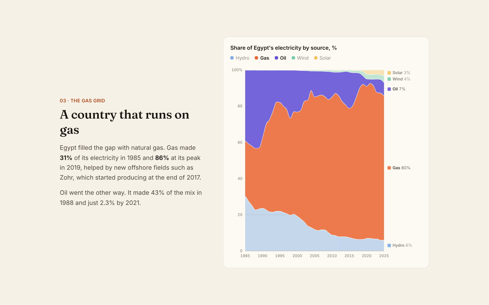
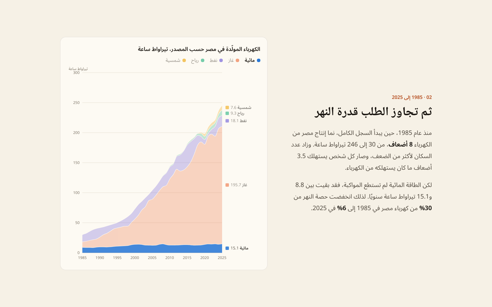

# Switched on: Egypt's electricity in data

A bilingual (English and Arabic) scrollytelling data story about how Egypt keeps the lights on for 118 million people. It follows 60 years of real data, from a grid built on the Nile, to one that runs on gas, through the 2023–24 power cuts, to the first big push for sun and wind.

**Live demo:** _add your Vercel link here_

> A portfolio project by [Mariam Hussein](https://www.mariam-hussein.website).




## The story

| Chapter | What the chart shows |
| --- | --- |
| 1. It started with the river | Hydro grows about 6 times between 1965 and 1982 as the Aswan High Dam comes online |
| 2. Then demand outgrew the river | Output grows 8 times since 1985, while hydro stays flat and falls from 30% to 6% of the mix |
| 3. A country that runs on gas | Gas climbs from 31% to 86% at its 2019 peak; oil falls from 43% to 2.3% |
| 4. Then the lights went out | The page itself goes dark: load shedding in 2023–24, and oil's share more than triples |
| 5. Here comes the sun | Solar and wind grow to 7.6 and 9.3 TWh; Benban solar park; renewables at their highest share since 2004 |
| 6. Egypt next to its neighbours | Electricity per person and renewables share against 8 countries and averages |
| 7. Pick a year | A year slider with play button showing the mix, people and kWh per person for any year |
| 8. What comes next | Progress towards the 42% renewables goal, and the El Dabaa nuclear plant |

## Features

- **One morphing chart:** the sticky chart animates between views as you scroll. It switches between stacked areas and lines, TWh and percentages, and zooms between time ranges, by tweening every band, scale and axis from the previous view.
- **"Lights out" moment:** during the power-cuts chapter, the whole page flickers and goes dark.
- **Readable charts:**
  - hover crosshair and tooltip on every year
  - arrow-key navigation, with values for each year
  - direct labels that don't collide
  - annotations for key events
  - a legend that shows which series the chapter is about
- **Accessible colour:** the 5-colour palette was checked for colour blindness in both light and dark mode. Labels and a full data table make sure no value depends on colour alone.
- **Arabic and English:** a full Arabic version (Modern Standard Arabic) with a right-to-left layout, Arabic fonts (Noto Naskh Arabic for headings, Noto Sans Arabic for body text), and translated chart labels, tooltips, country names and data table. The language is remembered, follows the browser by default, and can be linked directly with `?lang=ar` or `?lang=en`.
- **Light, dark and system themes**, plus support for reduced motion.
- **Open data:** a full table view and a CSV download.
- **Numbers that can't drift:** every figure in the text is calculated from the dataset at build time and checked by tests, so the story stays in sync if the data is updated.

## Tech stack

React 19 · TypeScript · Vite · Tailwind CSS v4 · d3-scale and d3-shape (maths only; React renders the SVG) · Vitest · Fraunces, Inter, Noto Naskh Arabic and Noto Sans Arabic

## How it works

- `scripts/build-data.mjs` downloads Our World in Data's energy CSV and writes a 10 KB `src/data/energy.json`. It holds Egypt's generation by source for every year, plus the comparison countries.
- `src/lib/story.ts` holds the logic:
  - `layout()` turns the rows into bands (stacked or unstacked, TWh or %)
  - `facts()` works out every number quoted in the story, such as peaks, shares and multiples
- `src/components/MixChart.tsx` encodes each chapter's view as one array of numbers (time range, y-scale, opacity and every band). When the chapter changes, it tweens from the old array to the new one with `requestAnimationFrame`, then redraws the paths with d3-shape. That's how a stacked TWh chart can smoothly turn into a percentage chart or a line chart.
- `src/lib/i18n.tsx` provides the language context: UI strings, country names and number formatting (Western digits in both languages, via `Intl.NumberFormat("ar-EG-u-nu-latn")`). It also sets `lang` and `dir` on the page. Chapter text in both languages is built from the same calculated facts, so the Arabic and English numbers can't disagree.
- Charts keep time running left to right in Arabic too, as Arabic news sites usually do, while the Arabic labels inside the SVG use right-to-left text direction. Horizontal bars and progress bars grow from the right in Arabic.
- `src/components/Scrolly.tsx` uses an `IntersectionObserver` to work out which chapter is in view. The trigger zone is different on mobile, where the chart sticks to the top half of the screen.

## Getting started

```bash
npm install
npm run dev
npm test
npm run build
npm run data
```

`npm run data` downloads the latest dataset and rebuilds `energy.json`. If the numbers change, the tests show which sentences need a second look.

## Deploy

Push to GitHub and import the repo on [Vercel](https://vercel.com). It's detected as Vite, and no environment variables are needed.

## Sources

- [Our World in Data, Energy dataset](https://github.com/owid/energy-data): Ember and the Energy Institute Statistical Review of World Energy
- [Benban Solar Park](https://en.wikipedia.org/wiki/Benban_Solar_Park)
- [Human Rights Watch, 2023](https://www.hrw.org/news/2023/08/08/egypt-electricity-cutbacks-threaten-rights) and [Ahram Online, 2024](https://english.ahram.org.eg/NewsContent/1/2/527405/Egypt/Society/Egypt-to-stop-loadshedding-power-cuts-on-Sunday-PM.aspx), on load shedding
- [Argus](https://www.argusmedia.com/en/news/2389361-cop-27-egypt-to-advance-42pc-renewables-by-2035-target), on the 42% renewables goal
- [Business Monthly](https://businessmonthlyeg.com/egypt-to-launch-first-el-dabaa-nuclear-unit-by-2028/), on El Dabaa

## Author

Made by [Mariam Hussein](https://www.mariam-hussein.website), Front-End Engineer · [GitHub](https://github.com/mariamhus)
